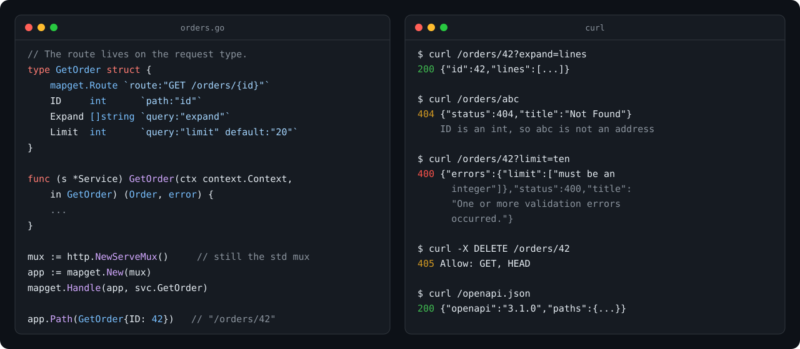
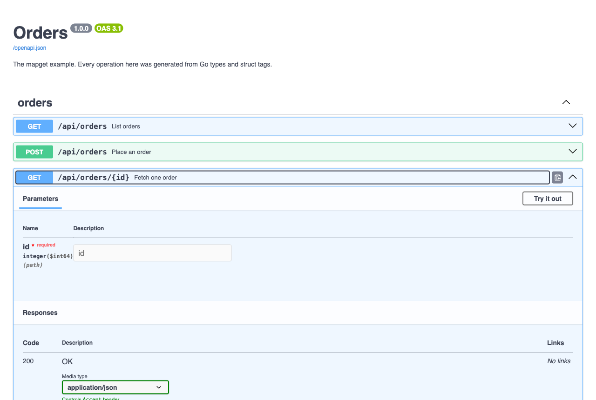

# mapget

[](https://github.com/AndyCross/mapget/actions/workflows/ci.yml)
[](https://pkg.go.dev/github.com/AndyCross/mapget)
[](go.mod)
[](https://github.com/AndyCross/mapget/releases)


[](LICENSE)

Typed, self-describing endpoints on Go's standard `http.ServeMux`, for people who came from ASP.NET Core.



Go 1.22 gave the standard mux methods and wildcards (`"GET /orders/{id}"`), which covers matching a request to a handler. ASP.NET Core does a good deal around its router that the mux leaves to you: route constraints, model binding, validation problem responses, link generation, route groups, a list of endpoints and an OpenAPI document. mapget is those parts, and nothing else. The mux still does all the routing, and the package has no dependencies outside the standard library.

```
go get github.com/AndyCross/mapget
```

Go 1.23 or later. The patterns arrived in 1.22, but on 1.22 `Request.PathValue` panics when a `{rest...}` wildcard's value is exactly `*`, which this package's fuzz test found, and 1.23 fixed it.

## Try it in a minute

```
git clone https://github.com/AndyCross/mapget && cd mapget
go run ./example
```

Then open http://localhost:8080/docs. Nothing in the example describes its API by hand: the page below is Swagger UI reading the document mapget generated from the Go types and their tags.



## Before and after

One endpoint: an integer id in the path, a `page` that defaults to 1, a search term.

<table>
<tr><th>net/http alone</th><th>with mapget</th></tr>
<tr><td>

```go
func getOrder(w http.ResponseWriter, r *http.Request) {
    id, err := strconv.Atoi(r.PathValue("id"))
    if err != nil {
        http.NotFound(w, r)
        return
    }
    q := r.URL.Query()
    page := 1
    if s := q.Get("page"); s != "" {
        if page, err = strconv.Atoi(s); err != nil {
            http.Error(w, "page must be an integer",
                http.StatusBadRequest)
            return
        }
    }
    w.Header().Set("Content-Type", "application/json")
    json.NewEncoder(w).Encode(find(id, page, q.Get("q")))
}

mux.HandleFunc("GET /orders/{id}", getOrder)
```

</td><td>

```go
type GetOrder struct {
    mapget.Route `route:"GET /orders/{id}"`
    ID   int    `path:"id"`
    Page int    `query:"page" default:"1"`
    Q    string `query:"q"`
}

func getOrder(ctx context.Context, in GetOrder) (Order, error) {
    return find(in.ID, in.Page, in.Q), nil
}

mapget.Handle(app, getOrder)
```

</td></tr>
</table>

The right-hand side also answers a bad `page` with problem details JSON, appears in the route table and the OpenAPI document, and can be linked to with `app.Path(GetOrder{ID: 42})`. It costs 46 ns a request more than the left (see [What it costs](#what-it-costs)).

## The route goes on the request type

In C# the route is an attribute on the action and the parameters say where they come from:

```csharp
[HttpGet("orders/{id:int}")]
public ActionResult<Order> Get(int id, [FromQuery] string[] expand)
```

Go has no attributes, but it has struct tags. A request type carries its route, and its fields say where each value comes from:

```go
type GetOrder struct {
    mapget.Route `route:"GET /orders/{id}"`
    ID     int      `path:"id"`
    Expand []string `query:"expand"`
}

func (s *Service) GetOrder(ctx context.Context, in GetOrder) (Order, error) {
    o, ok := s.orders[in.ID]
    if !ok {
        return Order{}, mapget.NotFound("there is no order with that id")
    }
    return o, nil
}

func main() {
    mux := http.NewServeMux()
    app := mapget.New(mux)
    mapget.Handle(app, svc.GetOrder)
    http.ListenAndServe(":8080", mux)
}
```

`Handle` registers `GET /orders/{id}` on the mux. The handler is an ordinary function of a context and a value, so a test calls it without building a request.

| Request | Answer |
|---|---|
| `GET /orders/42?expand=lines` | 200, the order as JSON |
| `GET /orders/abc` | 404. `ID` is an `int`, so `abc` is not an order's address. This is what `{id:int}` does in ASP.NET Core |
| `GET /orders/42?limit=ten` (were `limit` an `int`) | 400, problem details naming `limit` |
| `DELETE /orders/42` | 405 with `Allow: GET, HEAD`, from the mux |

If you would rather keep the pattern at the registration, as `app.MapGet` does, use `HandleAt`:

```go
mapget.HandleAt(app, "GET /orders/{id}", svc.GetOrder)
```

## Binding

| Tag | Reads |
|---|---|
| `path:"id"` | a wildcard in the pattern. Never a pointer or a slice |
| `query:"page"` | a query parameter. A slice field takes every value |
| `header:"If-None-Match"` | a request header |
| `cookie:"session"` | a cookie |
| `body:"json"` | the body as JSON. One per type. A pointer makes it optional |

`query`, `header` and `cookie` take `,required`, and a separate `default:"20"` tag for an absent value. A pointer field is nil when the value is absent. A field of type `*http.Request` is given the request.

Fields can be strings, booleans, integers, floats, `time.Duration`, or anything that implements `encoding.TextUnmarshaler`, which covers `time.Time`, `netip.Addr` and the UUID packages. Named types work, so `type OrderID int` binds.

Every failing query, header and cookie value is reported in one answer, in the shape of ASP.NET Core's `ValidationProblemDetails`:

```json
{
  "title": "One or more validation errors occurred.",
  "status": 400,
  "errors": {
    "page": ["must be an integer"],
    "size": ["is required"]
  }
}
```

A body with a content type other than JSON is answered with 415, one over the limit (1 MiB unless `mapget.MaxBody` says otherwise) with 413, and malformed JSON with 400.

## Constraints

The field's type is the constraint, so `int`, `time.Time` and `netip.Addr` fields need nothing more. For something narrower, such as ASP.NET Core's `{sku:regex(^[A-Z]{{2,6}}-[0-9]{{4}}$)}`, write a type whose `UnmarshalText` rejects everything else:

```go
type SKU string

var skuPattern = regexp.MustCompile(`^[A-Z]{2,6}-[0-9]{4}$`)

func (s *SKU) UnmarshalText(text []byte) error {
    if !skuPattern.Match(text) {
        return errors.New("not a SKU")
    }
    *s = SKU(text)
    return nil
}

type GetProduct struct {
    mapget.Route `route:"GET /products/{sku}"`
    SKU  SKU  `path:"sku"`
    Like *SKU `query:"like"`
}
```

| Request | Answer |
|---|---|
| `GET /products/TILE-0042` | 200, the handler runs with `in.SKU == "TILE-0042"` |
| `GET /products/tile-42` | 404, as a failed route constraint is in ASP.NET Core |
| `GET /products/TILE-0042?like=nope` | 400, `{"errors":{"like":["must be a valid SKU"]}, ...}` |

The rule is written once, on the type, and applies wherever a `SKU` is read: path, query string, header or cookie. `encoding/json` calls the same method, so a `SKU` in a JSON body is held to it too. The handler never sees a value that failed. This is a runnable example in the package (`Example_regexConstraint`).

One difference from ASP.NET Core: there, two routes can share a path and be told apart by constraint (`{id:int}` beside `{slug}`). The mux matches before any constraint runs, so here one pattern owns `/products/{x}`, and a field that needs to accept both shapes is a type that parses both.

## Mistakes stop the program at startup

`r.PathValue("idd")` on a pattern with `{id}` compiles, runs and returns an empty string. With mapget the pattern and the fields are checked against each other when the route is registered, and a mismatch panics, in the way the mux itself panics on a conflicting pattern:

```
mapget: main.GetOrder.ID reads path value "idd", which is not in the pattern "GET /orders/{id}"
mapget: pattern "GET /orders/{id}/{rev}" has the wildcard {rev} and main.GetOrder has no field tagged path:"rev"
mapget: main.ListOrders.Page: default "one" is not an integer
```

## Links

ASP.NET Core has `LinkGenerator` and `Url.Action`, which take a route or action name and an object of values, and return null at run time when the two do not fit. Here the request type is the route, so a link is a value of that type:

```go
app.Path(GetOrder{ID: 42})                              // "/orders/42"
app.Path(GetOrder{ID: 42, Expand: []string{"lines"}})   // "/orders/42?expand=lines"
```

Rename the field, change its type or move the route under a group and every link follows or fails to compile. `Path` and binding are inverses, and a fuzz test in the repository holds them to it: whatever address `Path` writes, a request for it through a real `ServeMux` binds to the same value.

`Path` returns an error for a path value no request can carry, such as an empty string. `MustPath` panics instead, for values known to be good.

## Groups and middleware

```go
app := mapget.New(mux)
api := app.Group("/api/v1", requireAuth)
tenant := api.Group("/tenants/{tenant}", loadTenant)

mapget.Handle(tenant, svc.GetOrder)                 // GET /api/v1/tenants/{tenant}/orders/{id}
api.HandleFunc("GET /healthz", healthz)             // plain handlers join in
```

This is `MapGroup`. Middleware is the usual `func(http.Handler) http.Handler`. A wildcard in a prefix needs a field like any other, so `GetOrder` above would need `Tenant string` tagged `path:"tenant"` or registration panics.

## Validation

Rules go in tags, beside the tag that says where the value comes from. The names are the JSON Schema keywords, so the same tags appear in the OpenAPI document. This is the job DataAnnotations do in ASP.NET Core (`[Range]`, `[StringLength]`, `[RegularExpression]`).

```go
type ListOrders struct {
    mapget.Route `route:"GET /orders"`
    Status string `query:"status" enum:"open,shipped"`
    Limit  int    `query:"limit" default:"20" minimum:"1" maximum:"100"`
}

type CreateOrder struct {
    mapget.Route `route:"POST /orders"`
    Body NewOrder `body:"json"`
}

type NewOrder struct {
    Customer string `json:"customer" minLength:"1" maxLength:"80"`
    Lines    []Line `json:"lines" minItems:"1" maxItems:"50"`
}

type Line struct {
    SKU string `json:"sku" pattern:"^[A-Z]{2,6}-[0-9]+$"`
    Qty int    `json:"qty" minimum:"1"`
}
```

| Tag | Applies to |
|---|---|
| `minimum`, `maximum` | numbers |
| `minLength`, `maxLength` | strings, counted in characters |
| `pattern` | strings, a regular expression |
| `enum` | strings and integers, comma separated |
| `minItems`, `maxItems` | slices. The tags above, on a slice field, apply to each element |

They work on `query`, `header`, `cookie` and `path` fields and on every field inside a JSON body, however deep. Every failure is reported at once, under the field's name or its path in the body:

```
$ curl -s --json '{"customer":"","lines":[{"sku":"tile","qty":0}]}' localhost:8080/api/orders
{
  "title": "One or more validation errors occurred.",
  "status": 400,
  "errors": {
    "customer": ["must be at least 1 character"],
    "lines[0].qty": ["must be at least 1"],
    "lines[0].sku": ["must match the pattern ^[A-Z]{2,6}-[0-9]+$"]
  }
}
```

- On a `path` field a rule is a route constraint, so a value outside it is a 404: `ID int` tagged `path:"id" minimum:"1"` is ASP.NET Core's `{id:int:min(1)}`.
- An optional parameter that is absent is not checked. Neither is a nil pointer, or a body field marked `omitempty` that holds its zero value.
- A tag that does not suit its field (`minimum` on a string, a pattern that does not compile, a default that breaks its own rule) panics at registration.
- A type with no rule tags costs nothing extra per request.

For a rule a tag cannot state, such as one that compares two fields, give the request type a `Validate() error` method. It runs after binding and after the tags have passed:

```go
func (c CreateOrder) Validate() error {
    if c.Body.Start.After(c.Body.End) {
        return mapget.FieldErrors{"end": {"must be after start"}}
    }
    return nil
}
```

`FieldErrors` becomes the same 400 as a tag failure. A `*mapget.Problem` is written as it is. Any other error is a 400 with its text.

## Results and errors

| Handler returns | Answer |
|---|---|
| any value | 200, JSON |
| `mapget.Created[T]{Location, Body}` | 201, `Location` header, JSON |
| `mapget.Accepted[T]{Location, Body}` | 202, JSON |
| `mapget.NoContent{}` or `struct{}{}` | 204 |
| an `http.Handler`, such as `http.RedirectHandler(...)` | whatever it writes |
| `*mapget.Problem`, or `mapget.NotFound(...)`, `Conflict(...)` and the rest, as the error | that status, as RFC 9457 problem details |
| `mapget.FieldErrors` as the error | 400 with `errors` |
| any other error | 500 with no detail. The error goes to `mapget.OnError`, which logs it with `slog` by default |

## The route table

```go
app.WriteRoutes(os.Stdout)
```

```
GET   /api/orders            main.ListOrders   []main.Order
POST  /api/orders            main.CreateOrder  mapget.Created[main.Order]
GET   /api/orders/{id}       main.GetOrder     main.Order
POST  /api/orders/{id}/ship  main.ShipOrder    mapget.NoContent
GET   /openapi.json          -                 -
```

`app.Routes()` returns the same as values.

## OpenAPI

```go
app.Handle("GET /openapi.json", app.OpenAPI(mapget.Info{Title: "Orders", Version: "1.0.0"}))
```

An OpenAPI 3.1 document from what is already written down: parameters from the tags, schemas from the Go types as `encoding/json` reads them, `minimum`, `pattern` and the other validation tags as schema keywords, 201 and 204 from `Created` and `NoContent`, and a `default` problem details response on every operation. `summary` and `tags` on the `Route` field and `doc` on any field add the words:

```go
type ListOrders struct {
    mapget.Route `route:"GET /orders" summary:"List orders" tags:"orders"`
    Status string `query:"status" doc:"Only orders in this state."`
    Limit  int    `query:"limit" default:"20"`
}
```

## What it costs

One endpoint with a path value, two query parameters and a small JSON answer, through a real `ServeMux`, against the same endpoint written by hand with `r.PathValue` and `strconv`. Go 1.27.3, Apple M4 Max, `go test -bench . -count 5`, median:

| | Time | Allocated | Allocations |
|---|---|---|---|
| By hand | 371 ns | 528 B | 8 |
| mapget | 417 ns | 560 B | 9 |

The tags are read once, at registration. A request costs a few `reflect` field sets on top of the parsing it needed anyway.

## What it does not do

- Route. The mux does that, so precedence, conflicts, `405`, host patterns and trailing-slash redirects are exactly the standard library's.
- Constraint syntax in the pattern, such as `{id:int}` or `{sku:regex(...)}`. The mux has none. Constraints work, and are written as types: see [Constraints](#constraints).
- Wildcards inside a segment, such as `report-{year}.{ext}`. The mux matches whole segments only.
- Dependency injection. Handlers are methods on a struct that holds what they need.
- Form and multipart bodies, content negotiation, XML. Take a `*http.Request` field, or register a plain handler beside the typed ones.
- Authentication. That is middleware.

One more thing the fuzz test found that is the mux's and not mapget's: on Go 1.27 a path segment that is exactly `%2F` matches no `{wildcard}` and is answered with 404, though `a%2Fb` matches and gives `a/b`. `Path` returns an error for a path value of `"/"` for that reason.

## Prior art

Most of this exists already, and you should know that before picking it.

[Huma](https://github.com/danielgtaylor/huma) is the established library for typed handlers and OpenAPI in Go. It has `path` and `query` struct tags, validation from tags, problem details and an OpenAPI 3.1 document, and it runs on the standard mux through an adapter as well as on chi, gin, echo and others. It is at v2 and has far more behind it than a library written in a week. If you want this for work, use Huma.

mapget was written for fun and to learn, alongside [a post about routing for C# developers](https://stepinto.dev). Where it differs:

- The route can live on the request type, as an attribute does in C#, and `Path` builds a link from a value of that same type.
- A path value that fails its type or its rules is a 404, as a failed route constraint is in ASP.NET Core. Huma answers 422 (checked on v2.41.0).
- Error bodies follow ASP.NET Core's `ValidationProblemDetails`: a 400 with `errors` keyed by field.
- It only targets `http.ServeMux`, has no dependencies, and is small enough to read in a sitting.

For matching the mux cannot express (regular expressions in the pattern, wildcards inside a segment), [chi](https://github.com/go-chi/chi) does both.

## Example

`example/` is an orders API with all of the above.

```
go run ./example
curl -s localhost:8080/api/orders/1
curl -s 'localhost:8080/api/orders?limit=abc'
curl -s --json '{"customer":"Ada","lines":[{"sku":"TILE-4","qty":12}]}' localhost:8080/api/orders
curl -s localhost:8080/openapi.json
```

Swagger UI is at http://localhost:8080/docs. The example loads it from a CDN; the library itself serves only the JSON document.

## Tests

87% of statements are covered. `FuzzPathRoundTrip` checks that link generation and binding are inverses through a real `ServeMux`, and runs in CI on Go 1.23 and the current release.

```
go test ./...
go test -run '^$' -fuzz FuzzPathRoundTrip -fuzztime 30s .
go test -run '^$' -bench . .
```

## Licence

MIT.
